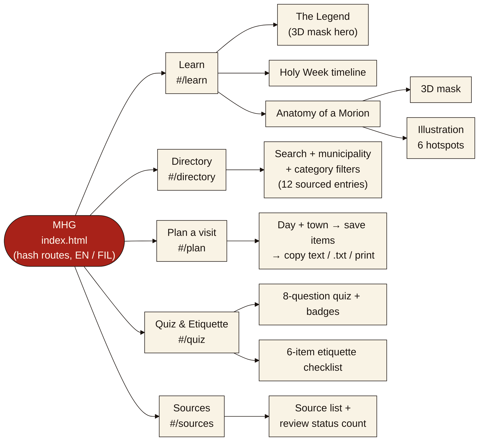
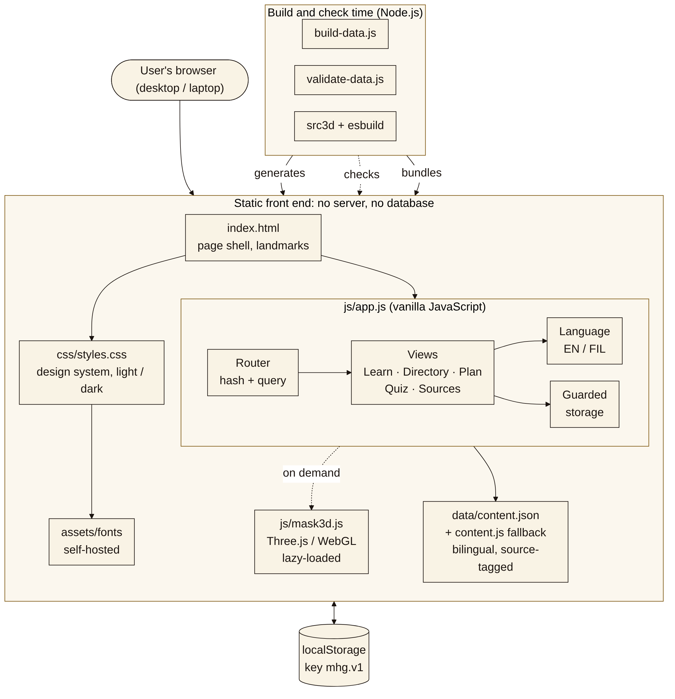
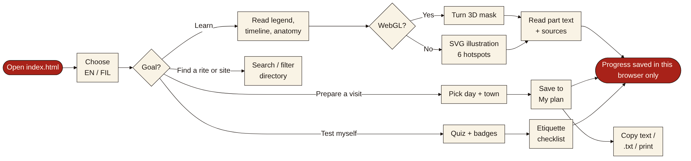
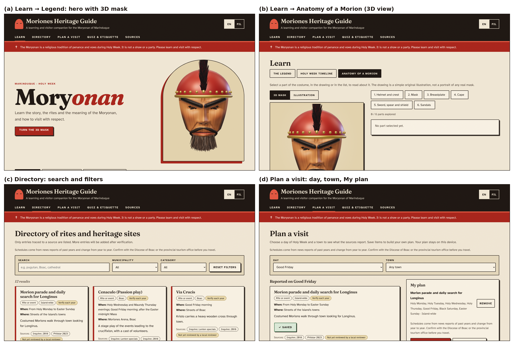

# Architecture and interface design (v7)

Diagrams are Mermaid sources in `docs/diagrams/*.mmd` with rendered PNGs next to them. Regenerate with `mmdc -i file.mmd -o file.png -c cfg.json -s 3 -b white`.

## 1. Sitemap

All pages live in one `index.html`. The address hash selects the view (`#/learn/anatomy`, `#/directory?q=&town=&cat=`, `#/plan?day=&town=&ids=`, `#/quiz`, `#/sources`).

## 2. Component diagram

- **No server and no database.** Content is bilingual JSON; `data/content.js` is a generated copy so the page also opens from disk.
- **`js/app.js`** holds the router, one render function per view, language handling and guarded `localStorage` access.
- **`js/mask3d.js`** is built from `src3d/mask3d.js` with Three.js and loaded only when a 3D view is shown; if WebGL is missing the SVG illustration is used.
- **`tools/`** runs only on a developer machine: `build-data.js` regenerates `content.js`, `validate-data.js` checks the content.

## 3. User flow

## 4. Interface design

Screens are 1440 × 900 screenshots of the implemented v7 interface (Chromium, software 3D rendering).

Design decisions:

- **Desktop-first.** Content width up to 78 rem, base type 106–125 % depending on screen width, three-column directory, two-column plan and anatomy layouts. Narrow screens collapse to one column but are not the focus.
- **Look: "penitential editorial".** Bone paper, near-black ink and one vermilion accent, hard offset shadows like woodblock prints, Fraunces for headings and Atkinson Hyperlegible for body text (both self-hosted, SIL OFL). A fixed banner states that the Moryonan is a religious tradition, not a show.
- **Navigation.** Five top-level links, one language switch (EN/FIL) in the header, three tabs inside Learn, and a two-way switch between 3D and illustration in Anatomy.
- **Targets and focus.** Interactive controls are at least 2.75 rem tall; a visible focus ring is used everywhere; the 3D view can be driven by arrow keys, + / − and R as well as the mouse.
- **Honest labelling.** Every content card shows its sources and a "not yet reviewed by a local reviewer" chip until a reviewer is recorded; the 3D model carries a note that it is an original generic design.
- **Motion.** One entrance animation on the home page and slow turning of the 3D mask; both are off when the browser asks for reduced motion.
