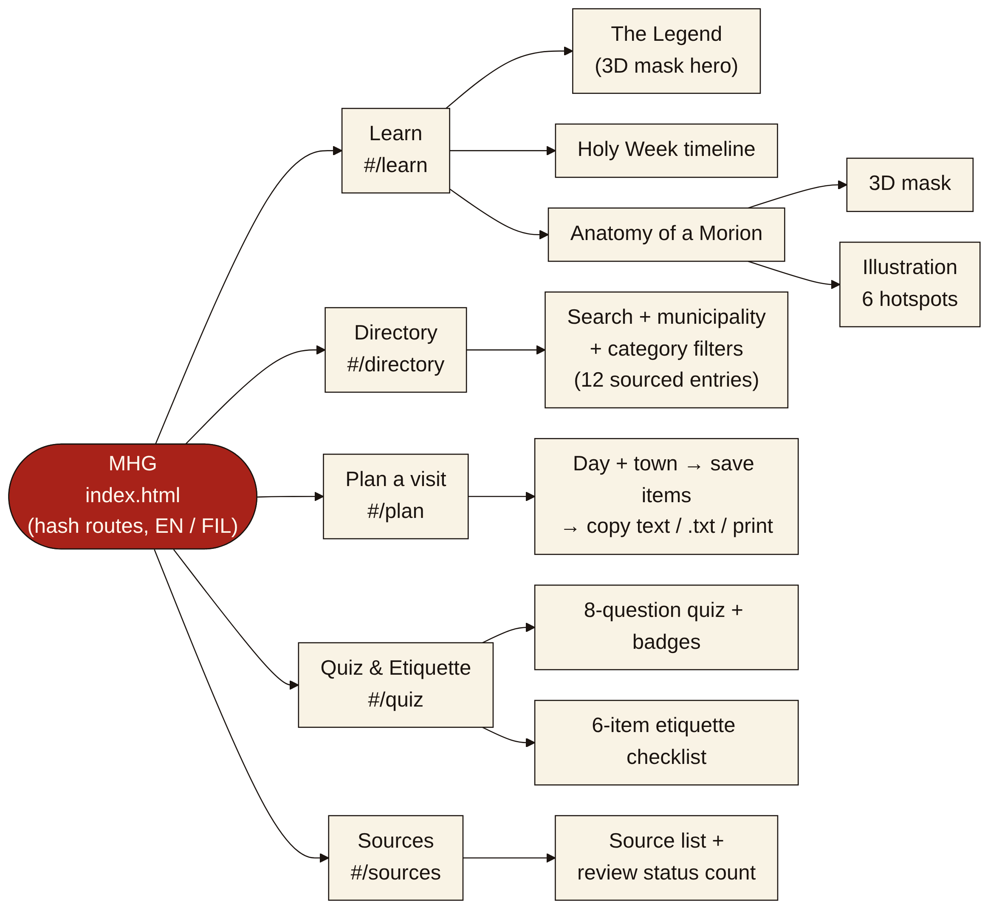
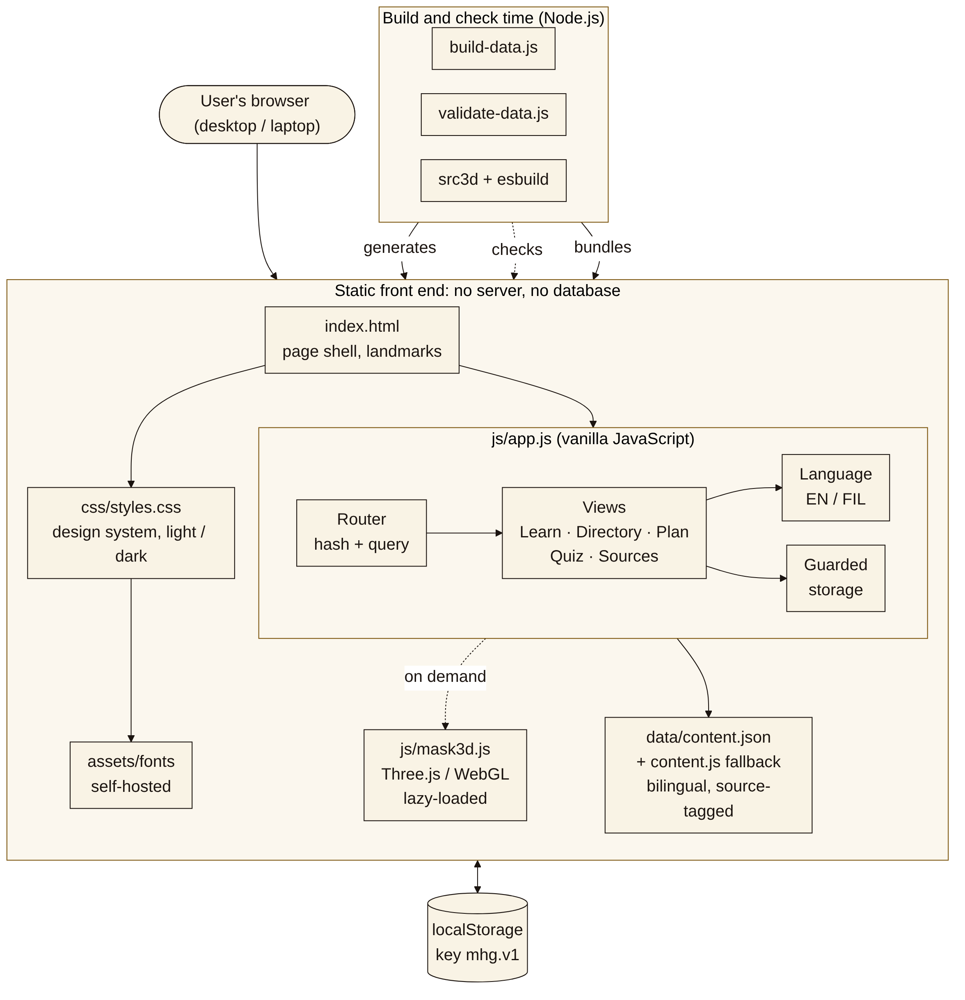
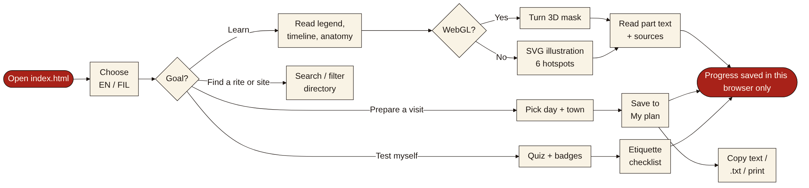
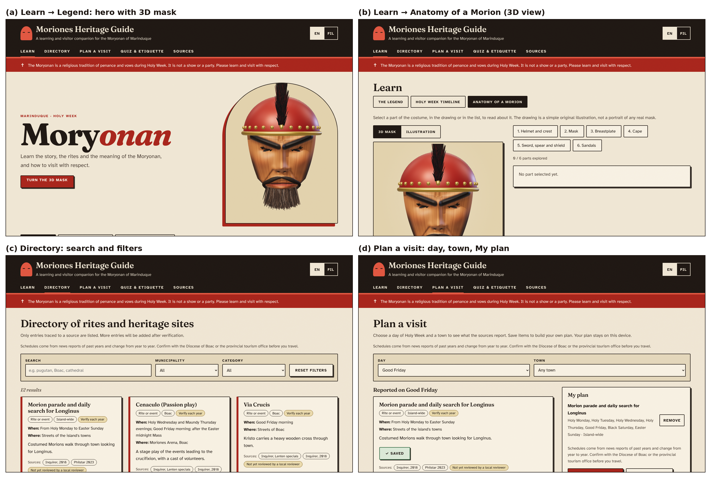

# MHG – Moriones Heritage Guide: An Interactive Web-Based Learning and Visitor Companion for the Marinduque Moriones Festival

**Allen Jodel Labay, Aldwin Nieva Montiano, Braelyn Ashlee Jao Lacsina, Micheal Vincent Ballerda, Robert Tristan, and Ashley Nicole Mandac Onte**  
*Group Ace Attorney, BSI/T–3E, College of Information and Computing Sciences, Marinduque State University, Boac, Marinduque, Philippines*

> DRAFT of 2026-11-06 (Week 2). Introduction and Methodology are drafted; Results and Discussion, Conclusion and the CRediT statement are placeholders. Text marked [to complete] needs the group's input or Week 3 data.

**Abstract.** The Moriones is a Lenten tradition of Marinduque that a preservation study describes as increasingly detached from its community. This project develops MHG, a frontend-only, bilingual (English/Filipino) web guide for laptop and desktop screens. It combines source-tagged heritage modules with an original 3D mask, a searchable directory of rites and heritage sites, a visit planner, and a quiz with a respectful-visitor etiquette checklist. It is built with semantic HTML, CSS, vanilla JavaScript, SVG, JSON and Three.js, and needs no server or database. Development testing in a desktop browser covered functional behavior, persistence, layout and automated accessibility checks. The effect on learning or visitor behavior has not been measured, content review by local cultural bearers is pending, and the Filipino text is not yet reviewed by a native speaker. [Abstract to be rewritten after the pilot test.]

**Keywords:** intangible cultural heritage; Moriones; web application; gamification; accessibility

## I. Introduction

### A. Background of the Study

This project belongs to the sector of tourism and cultural innovation. The Moriones, locally called the “Moryonan”, is a Lenten tradition of Marinduque in which participants wear masks and costumes of Roman soldiers as penance, thanksgiving or a vow. The 2003 UNESCO Convention defines intangible cultural heritage as the practices, representations, expressions, knowledge and skills that communities recognize as part of their cultural heritage [1], which is the category this tradition belongs to. A scholarly study of its preservation reports that the tradition’s historical value is declining, that it is becoming increasingly detached from the local community, and that little has been done to ensure the continuity of the mask-making craft, with ageing artisans calling for heirs [2]. At the same time the tradition draws visitors: the Philippine News Agency reports tourism figures for the province [3], and the Inquirer describes the Moriones as Marinduque’s top tourist draw [4].

### B. Problem Statement

Local reports show a tension between the tradition’s religious meaning and the attention it receives. Church and local officials are quoted saying that the tradition is “not really a show” [4], that “Moryonan” is preferred over “festival”, and that touristic attention has shifted “from Jesus to the Roman soldiers”; Mogpog Resolution No. 29-2017 penalizes “indiscriminate display” of the masks and costumes [5]. Together with the decline reported in [2], this indicates a need for accurate, respectful interpretive material that students, teachers and visitors can use.

The literature on digital heritage points to tools but not to this gap. Systematic reviews study gamification in and for cultural heritage [6], [7]; later work examines immersive virtual exhibitions [8], a collaborative platform for intangible heritage narratives [9], and inclusive design with digital storytelling for cultural tourism [10]. In the sources reviewed so far, these approaches are largely built on AR/VR or mobile applications. A preliminary search did not find a lightweight, web-based interactive guide on the Moriones or on Philippine intangible heritage among the results reviewed; the search was not exhaustive, so this gap is provisional. The group’s working hypothesis, not yet tested, is that young Marinduqueños and visitors have few accessible, engaging digital resources that explain the meaning, story and etiquette of the tradition.

### C. Project Objectives

General objective: To develop a frontend-only, bilingual (English/Filipino) web guide that gives students, visitors and tourism offices accurate, source-tagged and respectful information about the Moryonan of Marinduque, and to check how well it meets its requirements.

Specific objectives and their present status:

**TABLE I. SPECIFIC OBJECTIVES**

| # | Objective | How it is checked | Status |
|---|---|---|---|
| O1 | Deliver at least three working interactive features (heritage modules, searchable directory, quiz with etiquette checklist). | Feature walk-through and browser checks (docs/TESTING.md #2–#8). | Met; two extensions added (Plan a visit, 3D mask) |
| O2 | Attach at least one source id to every factual content item and label unsourced guidance as “pending”. | tools/validate-data.js (exit code 0 on the real data; broken test copy fails). | Met (checked by the validator) |
| O3 | Provide every interface string and content item in both English and Filipino, with the Filipino reviewed by a native speaker before final submission. | Validator checks both languages are present; native-speaker review log. | Drafted; review pending |
| O4 | Meet the automated WCAG 2.x A/AA checks on all views in light and dark themes and make every interaction keyboard-operable. | axe-core scan (14 view/theme runs, 0 violations in v7); keyboard checks; screen-reader check planned. | Met for automated checks; manual checks pending |
| O5 | Collect no personal data and require no server or database; keep all state in the browser. | Design review and code inspection (no network calls except links to sources). | Met by design |
| O6 | Pilot the guide with at least five students or visitors using the usability kit (five tasks and the SUS questionnaire) and report completion rate and SUS score. | docs/USABILITY_TEST.md; results to be reported as measured, with no target claimed in advance. | Planned (Week 3) |
| O7 | Have the content reviewed by at least one local reviewer (cultural bearer, tourism office or Diocese) and record the review in content.json. | Review labels on each item; Sources page counts reviewed items. | Planned; 0 items reviewed so far |

### D. Proposed Solution and Contribution

MHG is a frontend-only web guide with three core features: interactive heritage modules (the legend of Longinus, a Holy Week timeline and an anatomy of a Morion with an original 3D mask and a clickable SVG costume glossary); a searchable, filterable directory of rites and heritage sites; and a quiz with badges and a respectful-visitor etiquette checklist. Two extensions add a visit planner and the 3D mask. Every factual item carries a source tag, and where sources disagree, for example on the origin date, both are shown.

The design draws on learning and gamification research. Retrieval practice through quizzes improved long-term retention more than restudying in a controlled study [11]. Badges are a game design element used outside games, which is how gamification is defined [12], and a literature review of empirical studies found that the effects of gamification depend on the context and on the users [13]. The group therefore treats the quiz and badges as design choices to be tested, not as proven gains. The intended contribution is a small, reusable, source-traceable and respectful web resource whose content can be reviewed and reused by schools and tourism offices; no learning or engagement improvement is claimed.

### E. Scope and Limitations

Intended users are senior high school and college students and teachers in Marinduque, visitors and returning Marinduqueños who attend during Lent, and cultural and tourism offices that could maintain or reuse the content. The guide is designed for laptop and desktop screens. Included are static pages, JSON content, SVG and 3D interactions, browser storage and an English/Filipino toggle. Excluded are a server, database, accounts, payments or bookings, maps and live event data, user-generated content, AR/VR headsets, and any collection of personal data. The group is not an official tourism or Church body, and the tradition is presented as a religious practice, not entertainment.

Known limitations: the Filipino text is AI-drafted and unreviewed by a native speaker; no content has yet been reviewed by local cultural bearers; schedules come from news reports of past years and are labelled “verify each year”; the directory has 12 entries; and no user study has been done. [to complete after Week 3]

## II. Methodology

### A. Development Approach

The group worked in short iterations over the course schedule. In Week 1 it proposed three project concepts and selected MHG. In Week 2 it defined the problem, collected and checked 20 sources, wrote the requirements and built a minimum viable product (MVP). Later iterations responded to problems the group met: the page showed “not found” when launched from VS Code in Edge because browsers block fetch() of a local JSON file, which led to a generated content.js fallback; the interface was redesigned; a visit planner and reviewer labels were added; and on 5 November the group decided that the guide targets PC and laptop users first, which led to the desktop-first layout, the removal of an offline-app (PWA) experiment, a fix to the plan-copy function and the addition of the 3D mask.

AI-assisted development was used and is disclosed in AI_DISCLOSURE.md (10 entries so far: Claude, GPT and GitHub Copilot). AI output was run and tested in a browser, content facts and references were checked against their publisher or standards pages, and two items remain unverified by humans: the Filipino text and the cultural accuracy of the content. [Members to confirm their own prompts and responsibilities.]

### B. Requirements and Core Features

The requirements follow from the problem in Section I-B. TABLE II maps each problem to the features that address it; the full list of 14 functional and 7 non-functional requirements, with the place where each is implemented and its test evidence, is in docs/REQUIREMENTS.md.

**TABLE II. REQUIREMENTS-TO-FEATURES MAPPING**

| Problem or need | Requirements | Feature that addresses it |
|---|---|---|
| Tradition detached from the community; little accessible explanation [2] | FR1–FR5 | F1 Interactive heritage modules: legend, timeline, 3D mask and costume glossary, in English and Filipino |
| Need for accurate, respectful material; “not a show” [4], [5] | FR13, NFR5, NFR6 | Source tag on every item, “not yet reviewed” labels, a respect notice on every page, original illustrations |
| Finding rites and heritage sites | FR6–FR7 | F2 Searchable, filterable directory (12 sourced entries) |
| Visitors need context and etiquette | FR8–FR9, FR12 | F3 etiquette checklist; E1 visit planner (copy as text, .txt, print) |
| Retention and engagement [11], [12], [13] | FR10–FR11, FR14 | F3 Quiz with feedback and sources, five badges, saved progress |

### C. System Architecture and Design

MHG is a static front end. A single index.html loads a generated data file and one script; the address hash selects the view (Fig. 1), so the site opens from disk or from any static host. js/app.js holds the router, one render function per view, language handling and guarded localStorage access. The 3D mask is a separate script loaded only when needed. Content lives in bilingual JSON; two small Node.js tools regenerate and validate it at development time (Fig. 2). Fig. 3 shows the main user flow: choose a language, then learn, search, plan a visit or test oneself; progress is kept in the browser only.

*Fig. 1. Sitemap of MHG (hash routes in a single index.html).*

*Fig. 2. Component diagram: static front end, lazy-loaded 3D module, browser storage and build-time tools.*

*Fig. 3. User flow for a visitor or student.*

The interface is desktop-first: content width up to 78 rem, larger type on wide screens, three-column lists and two-column layouts, collapsing to one column on narrow screens. The visual style uses bone paper, near-black ink and one vermilion accent, with self-hosted Fraunces and Atkinson Hyperlegible fonts. Controls are at least 2.75 rem tall and have a visible focus ring. Fig. 4 shows the implemented screens.

### D. Technology Selection and Comparative Justification

TABLE III compares vanilla JavaScript with React for this project. A comparison of Angular, React and Vue for single-page front ends [14] favored React among those three, but it does not include vanilla JavaScript, so the group’s decision rests on its own requirements: five small views, no server and the need to open the site from disk.

**TABLE III. VANILLA JAVASCRIPT COMPARED WITH REACT FOR THIS PROJECT**

| Criterion | Vanilla JavaScript | React |
|---|---|---|
| Project complexity | Five views, a filter, a quiz and a plan list: limited interactions. | Suited to large component-based interfaces. |
| Component organisation | Written by hand: one render function per view in a single file (js/app.js, about 870 lines). | Provides a defined component model. |
| Dependencies and tooling | None to run the site; Three.js (MIT) only for the 3D mask, prebuilt with esbuild. | Needs a package manager and a build step. |
| Static hosting / opening from disk | Works from file:// and GitHub Pages without a build. | Needs a build to produce static files. |
| Decision | Selected for the MVP. Revisit if the views become reusable components. | Not selected now; a framework comparison in the literature [14] covers Angular, React and Vue but not vanilla JavaScript. |

Other choices follow the same logic. Semantic HTML with WAI-ARIA roles supports keyboard and assistive-technology use [15] and the group checks against WCAG 2.2 [16]. Browser storage [17] keeps progress on the user’s device without accounts. Inline SVG gives a scalable, focusable costume diagram without image-licensing risk. For the 3D mask the group chose Three.js (MIT licence) rather than hand-written WebGL: the library is about 0.5 MB (about 0.13 MB gzipped) in the group’s build, is loaded only when a 3D view is shown, and the model is generated in code, so no image or model licence is involved. If WebGL is unavailable, the SVG illustration is shown instead.

### E. Development and Implementation

All content is in data/content.json: sources, interface strings, legend, eight Holy Week rites, six costume-part glossary entries, twelve directory entries with municipalities, categories and days, eight quiz questions, six etiquette items and the filters. Entries are drawn from news and government reports [4], [18], [19], [20] and the scholarly sources above. Every item in both English and Filipino has a list of source identifiers; etiquette guidance without a source is marked “pending”. tools/validate-data.js fails if a source is unknown, a language is missing, a quiz answer is invalid or the generated data file is out of date. Because browsers block fetch() of a local JSON file, tools/build-data.js writes the same data to data/content.js, which the page uses when it is opened from disk.

The directory filters by keyword (case- and accent-insensitive, English or Filipino), municipality and category, and writes the filter state into the address so a view can be shared. The visit planner selects rites by day and town, keeps saved items in localStorage and produces the plan as plain text for copying, downloading or printing; a link is offered only when the site is online, because a link to a local file cannot be opened by other people. The quiz scores eight questions with feedback and a source and awards five badges. Each content card shows a review label that stays “not yet reviewed by a local reviewer” until a reviewer is recorded in the data. The 3D mask is procedural: a carved face shell, helmet, horsehair crest, beard, eyelashes and optional flowers are built from code with controls for turning, zooming, pausing and highlighting parts. It is an original generic design in the traditional style described by the cited sources, not a copy of a particular mask or maker.

### F. Evaluation Procedure

Tests actually performed (docs/TESTING.md, #1–#34) were automated browser checks in Chromium run during development by the AI-assisted build: console errors on every view; keyboard operation of the SVG hotspots; directory counts for sample searches and filters; a full quiz run and its badges; persistence after reload; language switching; the plan’s copy, download and fallback paths; the 3D views and their fallback when WebGL is disabled; layout at 1440 and 1920 px wide; opening from disk; and an axe-core scan against WCAG 2.x A and AA on seven views in light and dark themes. The 3D checks used a software renderer, so speed was not measured.

Not yet performed, and therefore not claimed: a pilot test with at least five students or visitors using the usability kit (five tasks and the SUS questionnaire), a screen-reader check, tests in Firefox, Safari and Edge on the group’s computers, a test on real graphics hardware, native-speaker review of the Filipino text, and review by a local cultural bearer. These are planned for Week 3. [to complete]

## III. Results and Discussion

> Outline for Week 3. For each core feature the guidelines ask for: name and purpose, requirement addressed, implemented behavior, screenshot, observed testing result, and interpretation or limitation. Observed results below are development tests only.

*Fig. 4. Implemented interface (v7, 1440 × 900): (a) Legend with 3D hero, (b) Anatomy 3D view, (c) Directory, (d) Plan a visit.*

**TABLE IV. CORE FEATURES AND OBSERVED DEVELOPMENT-TEST RESULTS**

| Feature | Requirements | Observed result (development tests) | Still to do |
|---|---|---|---|
| F1 Interactive heritage modules (incl. 3D mask) | FR1–FR5 | Legend, 8-item timeline, 6 hotspots operable by keyboard; 3D mask loads without errors and falls back to the illustration; 0 axe violations | Pilot test; native-speaker and cultural review; check 3D speed on real hardware |
| F2 Searchable directory | FR6–FR7 | 12 entries; sample searches and filters gave the expected counts; filter state restored from the address | More verified entries; pilot test |
| F3 Quiz, badges, etiquette checklist | FR10–FR12, FR14 | A full quiz run awarded the expected badges; best score, badges and checklist persisted after reload | Pilot test; local review of the pending etiquette items |
| E1 Plan a visit | FR8–FR9 | Day and town filters gave the expected items; the plan was saved, copied as text and downloaded; the text-box fallback works when the clipboard is blocked; the link appears only when online | Confirm copy on the group’s Windows computers |

[to complete: for each feature, add the screenshot, the pilot-test result and an interpretation of what the result does and does not show. Discuss O1–O7 from TABLE I against the evidence, and report any difference between the Filipino and English versions found by the reviewer.]

## IV. Conclusion

[to complete after the pilot test: restate the problem and what was built, summarise what the evidence supports and what it does not, and give the main limitations and next steps. Do not state learning or engagement gains unless they were measured.]

## Author Contributions (CRediT)

[to complete: each member states their own contributions using CRediT roles, for example conceptualization, methodology, software, validation, writing – original draft, writing – review and editing, and notes where AI tools were used. These must be written by the members themselves and match CONTRIBUTIONS.md and AI_DISCLOSURE.md.]

## References

[1] UNESCO, “Convention for the Safeguarding of the Intangible Cultural Heritage,” Paris, France, Oct. 17, 2003. [Online]. Available: https://ich.unesco.org/en/convention  
[2] C. S. Chan, “Folklore without a folk: Questions in the preservation of the Marinduque Moriones heritage,” Int. J. Heritage Stud., vol. 23, no. 1, pp. 29–40, 2017, doi: 10.1080/13527258.2016.1232746.  
[3] M. Gil, “Marinduque tourism sector posts strong Q1 performance,” Philippine News Agency, May 10, 2024. [Online]. Available: https://alpha.pna.gov.ph/articles/1224509  
[4] “Lenten tradition: The many faces of penitence in Marinduque,” Inquirer News, Mar. 27, 2018. [Online]. Available: https://newsinfo.inquirer.net/?p=978339  
[5] “Moriones: solemn tradition, not festive occasion,” Inquirer News, n.d. (published c. 2018). [Online]. Available: https://newsinfo.inquirer.net/?p=978072  
[6] I. Khan, A. Melro, A. C. Amaro, and L. Oliveira, “Systematic review on gamification and cultural heritage dissemination,” J. Digit. Media Interact., vol. 3, no. 8, pp. 19–41, 2020, doi: 10.34624/jdmi.v3i8.21934.  
[7] C. G. Marques, J. P. Pedro, and I. Araújo, “A systematic literature review of gamification in/for cultural heritage: Leveling up, going beyond,” Heritage, vol. 6, no. 8, pp. 5935–5951, 2023, doi: 10.3390/heritage6080312.  
[8] H. Wang, Z. Gao, X. Zhang, J. Du, Y. Xu, and Z. Wang, “Gamifying cultural heritage: Exploring the potential of immersive virtual exhibitions,” Telematics Inform. Rep., vol. 15, Art. no. 100150, Sep. 2024, doi: 10.1016/j.teler.2024.100150.  
[9] G. Mathioudakis et al., “InCulture: A collaborative platform for intangible cultural heritage narratives,” Heritage, vol. 5, no. 4, pp. 2881–2903, 2022, doi: 10.3390/heritage5040149.  
[10] K. Kasemsarn, D. Harrison, and F. Nickpour, “Applying inclusive design and digital storytelling to facilitate cultural tourism: A review and initial framework,” Heritage, vol. 6, no. 2, pp. 1411–1428, 2023, doi: 10.3390/heritage6020077.  
[11] H. L. Roediger III and J. D. Karpicke, “Test-enhanced learning: Taking memory tests improves long-term retention,” Psychol. Sci., vol. 17, no. 3, pp. 249–255, 2006, doi: 10.1111/j.1467-9280.2006.01693.x.  
[12] S. Deterding, D. Dixon, R. Khaled, and L. Nacke, “From game design elements to gamefulness: Defining ‘gamification’,” in Proc. MindTrek, 2011.  
[13] J. Hamari, J. Koivisto, and H. Sarsa, “Does gamification work? A literature review of empirical studies on gamification,” in Proc. 47th Hawaii Int. Conf. Syst. Sci. (HICSS), 2014, pp. 3025–3034, doi: 10.1109/HICSS.2014.377.  
[14] F. Ilievska and S. Gramatikov, “Analysis and comparative evaluation of front-end technologies for web application development,” in ICT Innovations 2022 Web Proc., Sep. 2022, pp. 209–223. [Online]. Available: https://proceedings.ictinnovations.org/2022/paper/575/analysis-and-comparative-evaluation-of-front-end-technologies-for-web-application-development  
[15] J. Diggs, J. Nurthen, M. Cooper, and C. MacLeod, Eds., “Accessible Rich Internet Applications (WAI-ARIA) 1.2,” W3C Recommendation, Jun. 6, 2023. [Online]. Available: https://www.w3.org/TR/WAI-ARIA/  
[16] A. Campbell, C. Adams, R. B. Montgomery, M. Cooper, and A. Kirkpatrick, Eds., “Web Content Accessibility Guidelines (WCAG) 2.2,” W3C Recommendation, Oct. 5, 2023. [Online]. Available: https://www.w3.org/TR/2023/REC-WCAG22-20231005/  
[17] I. Hickson, “Web Storage (Second Edition),” W3C Recommendation, Apr. 19, 2016. [Online]. Available: https://www.w3.org/TR/2016/REC-webstorage-20160419/  
[18] “Moriones, other Lenten specials color Marinduque,” Inquirer News, n.d. [Online]. Available: https://newsinfo.inquirer.net/172307/moriones-other-lenten-specials-color-marinduque  
[19] D. Dy-Zulueta, “Story of faith: Marinduque’s Moriones Festival takes place this Holy Week,” Philstar.com, Apr. 6, 2023. [Online]. Available: https://www.philstar.com/lifestyle/travel-and-tourism/2023/04/06/2257107/story-faith-marinduques-moriones-festival-takes-place-holy-week  
[20] “Boac Cathedral declared as important cultural property,” Manila Bulletin, Feb. 22, 2020. [Online]. Available: https://mb.com.ph/2020/02/22/boac-cathedral-declared-as-important-cultural-property  
